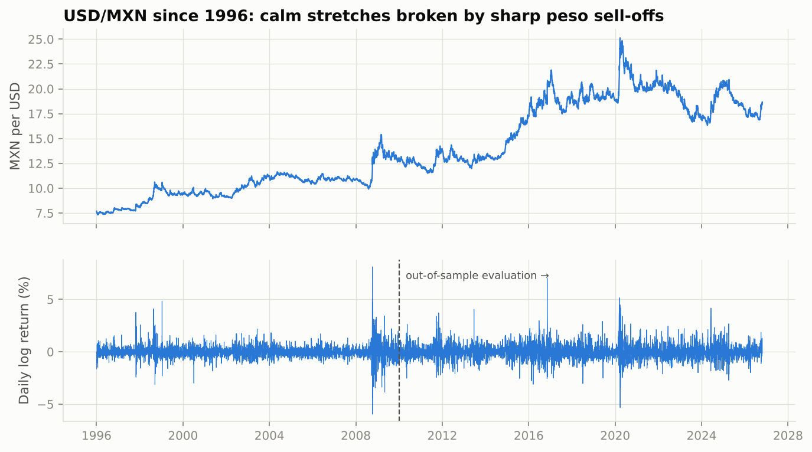
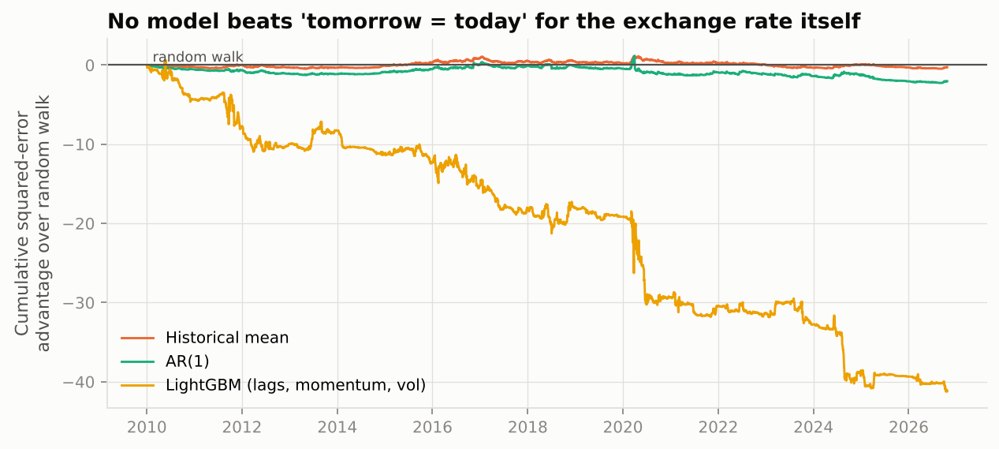
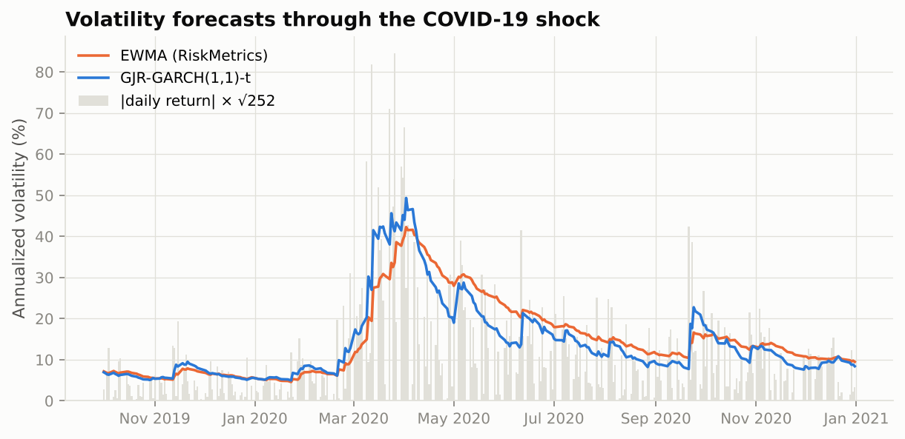
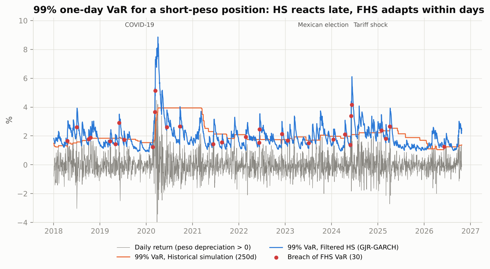
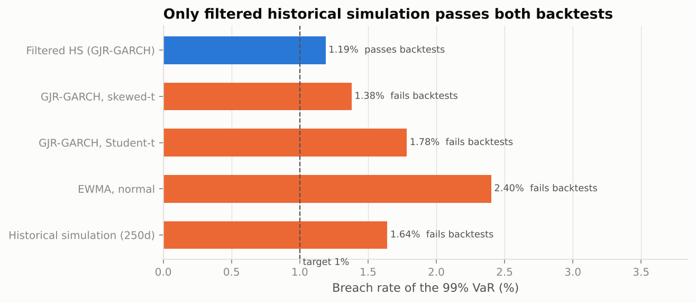

# USD/MXN: What Can (and Can't) Be Forecast

[](https://github.com/c4r0l13/usdmxn-volatility-var/actions/workflows/ci.yml)


Thirty years of the peso–dollar exchange rate and three questions, each answered with a walk-forward evaluation over **16 years and 4,205 trading days (2010–2026)** that includes the 2016 US election, COVID-19, the 2024 Mexican election and the 2025 tariff shock.

| Question | Answer |
|---|---|
| **A. Can we forecast tomorrow's exchange rate?** | **No.** No model beats "tomorrow = today". Machine learning is *significantly worse* (Diebold-Mariano p = 0.005). |
| **B. Can we forecast tomorrow's volatility?** | **Yes.** GARCH-family models track risk regimes within days. Their edge over the simple RiskMetrics EWMA is small and not statistically significant. |
| **C. Can we build a 99% Value-at-Risk that holds up?** | **Only one of five methods passes** both regulatory backtests: filtered historical simulation, at the same average capital as plain historical simulation. |



---

## A. The exchange rate is (almost) a random walk

Next-day log returns were forecast with a historical mean, an AR(1) and a LightGBM model on 10 lags, momentum and recent volatility. Everything was re-estimated monthly on an expanding window.

| Model | RMSE vs random walk | Directional accuracy | Diebold-Mariano p |
|---|---:|---:|---:|
| Historical mean | 1.000 | 47.7% | 0.85 |
| AR(1) | 1.000 | 47.4% | 0.34 |
| LightGBM | **1.009** (worse) | 49.4% | **0.005** |



This is the expected answer for a liquid currency, and it is the most important result in the repo. A flexible model finds patterns in noise, and those patterns fail most in the moments that matter most: LightGBM's losses come in steps during the March 2020 and June 2024 sell-offs. **Being able to show that a model doesn't work, and why, is part of the job.**

## B. Volatility *is* forecastable

The square of tomorrow's return is noisy but predictable on average. Five models were compared on the QLIKE loss (Patton, 2011), which ranks volatility forecasts correctly even with a noisy proxy:

| Model | QLIKE (lower is better) | vs EWMA (DM p) |
|---|---:|---:|
| EWMA, RiskMetrics λ = 0.94 | 1.518 | – |
| GARCH(1,1), Student-t | 1.512 | 0.50 |
| **GJR-GARCH(1,1), Student-t** | **1.507** | 0.35 |
| GJR-GARCH(1,1), skewed-t | 1.507 | 0.35 |
| HAR (daily / weekly / monthly) | 1.553 | 0.015 (worse) |



**The peso has a reversed leverage effect.** In equities, *falling* prices raise volatility. In USD/MXN, a *depreciation* of the peso (rising USD/MXN) raises next-day variance about **3× more** than an appreciation of the same size (GJR shock coefficients 0.17 vs 0.05). The return distribution is also right-skewed (skewness +0.66 since 2010, fitted skewed-t λ = +0.16). Sell-offs are sharper than rallies, and part C depends on modelling that.

## C. 99% Value-at-Risk backtest

Position: short pesos (for example a company with dollar liabilities), so the loss is a rise in USD/MXN. Each method produces a one-day VaR every morning, and breaches are tested with Kupiec (right frequency?) and Christoffersen (breaches clustered?).

| Method | Breach rate (target 1.00%) | Kupiec p | Independence p | Avg VaR | Worst 250-day Basel zone |
|---|---:|---:|---:|---:|---|
| Historical simulation, 250 days | 1.64% | <0.001 | **0.006** | 1.94% | 🔴 red (10) |
| EWMA, normal | 2.40% | <0.001 | 0.34 | 1.59% | 🔴 red (11) |
| GJR-GARCH, Student-t | 1.78% | <0.001 | 0.76 | 1.69% | 🟡 yellow (8) |
| GJR-GARCH, skewed-t | 1.38% | 0.019 | 0.83 | 1.83% | 🟡 yellow (7) |
| **Filtered HS (GJR-GARCH)** | **1.19%** | **0.23** ✅ | **0.63** ✅ | 1.92% | 🟡 yellow (7) |



What the table shows:

- **Plain historical simulation, the industry default, fails twice.** It breaches too often, and its breaches come in clusters: after a shock it takes months for the 250-day window to "notice", then it overshoots for a year (the flat orange line through 2020–2021).
- **Normality is the biggest error.** EWMA with normal quantiles breaches 2.4× more often than promised. Fat tails (Student-t) help, and skewness (skewed-t) helps further.
- **Filtered HS wins at no extra cost.** It combines GJR-GARCH volatility with the *empirical* distribution of standardized shocks. It needs the **same average capital** as plain historical simulation (1.92% vs 1.94%) and has 28% fewer breaches that don't cluster.
- **Honest caveat:** at the 95% level all five methods breach slightly too often (5.8–7.0%), and no method stays in the green zone in every 250-day window. Monthly re-estimation is too slow for the sharpest regime changes. See next steps.



## Methodology

- **Data:** Federal Reserve H.10 noon buying rates (MXN per USD), 1996–2026. 1993–95 is excluded because the peso was not freely floating until after the Tequila crisis.
- **Walk-forward:** every model is re-estimated every 21 trading days on all data available up to that day and produces strictly one-step-ahead forecasts. Tests verify that a shock on day *t* cannot change the forecast *for* day *t*.
- **Statistics:** Diebold-Mariano with the Harvey-Leybourne-Newbold correction, QLIKE loss, Kupiec POF, Christoffersen independence, Basel traffic light, all implemented and unit-tested in [`stats.py`](src/fxrisk/stats.py).

## Reproduce

```bash
git clone https://github.com/c4r0l13/usdmxn-volatility-var.git
cd usdmxn-volatility-var
python -m venv .venv && source .venv/bin/activate
make install
make data      # latest daily rates
make run       # ~1.5 min -> reports/
make test
```

Because `make data` downloads the latest series, re-running extends the backtest to the current date.

## Project structure

```
usdmxn-volatility-var/
├── src/fxrisk/
│   ├── data.py       # load rates, log returns
│   ├── models.py     # walk-forward point, volatility (EWMA/GARCH/GJR/HAR) and VaR forecasts
│   ├── stats.py      # QLIKE, Diebold-Mariano, Kupiec, Christoffersen, Basel zones
│   └── pipeline.py   # parts A-C, tables and figures
├── tests/            # statistics on known cases, no look-ahead, VaR coverage on simulated GARCH data
└── reports/          # metrics.json, results.md, figures/
```

## Next steps

- **Faster adaptation:** re-estimate weekly, or add intraday realized volatility (which is what HAR was designed for) to react within the day.
- **Expected Shortfall** with the Acerbi-Szekely backtest, the measure Basel FRTB now requires.
- **Multi-day horizons** (10-day VaR) with simulation instead of the square-root-of-time rule.

## References

Patton (2011), *Journal of Econometrics* · Glosten, Jagannathan & Runkle (1993), *Journal of Finance* · Corsi (2009), *Journal of Financial Econometrics* · Kupiec (1995), *Journal of Derivatives* · Christoffersen (1998), *International Economic Review* · Barone-Adesi, Giannopoulos & Vosper (1999), *Journal of Futures Markets* (filtered HS) · Meese & Rogoff (1983), *Journal of International Economics* (random walk).
